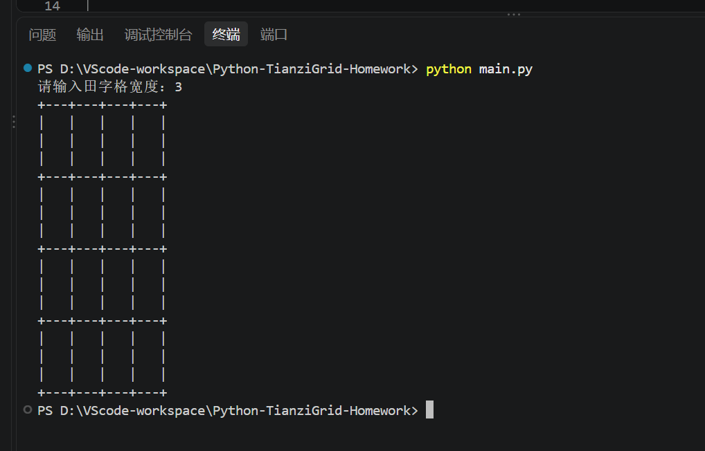
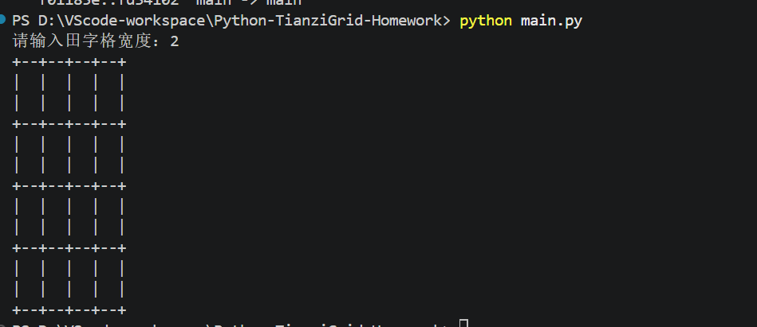
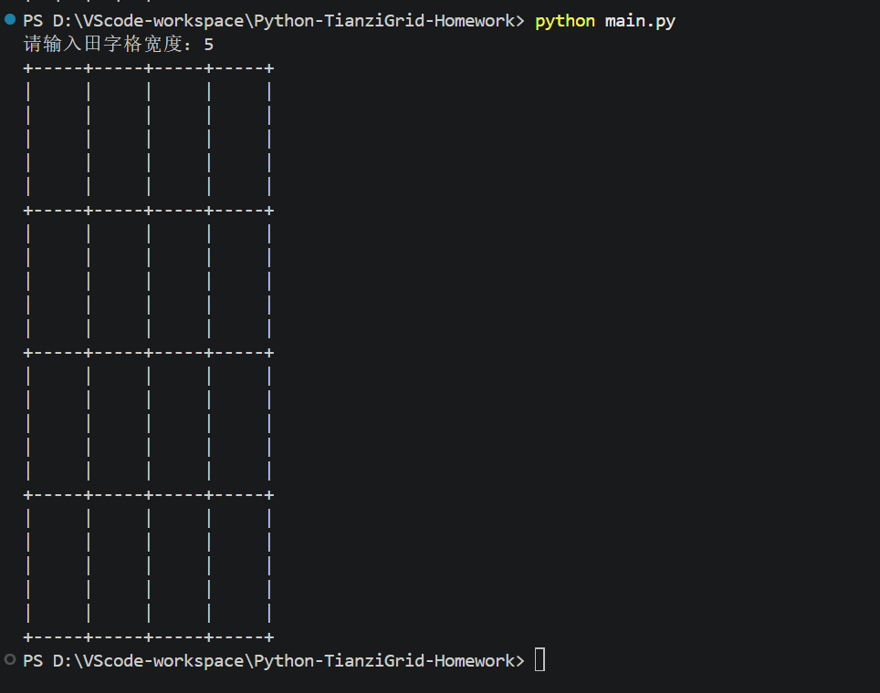
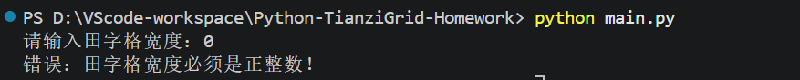
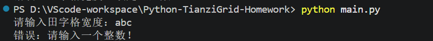

# Python 字符田字格绘制作业

## 一、项目简介

本项目是《Python语言程序设计基础（第3版）》第196页程序练习题5.1——字符田字格绘制。

题目要求使用 Python 编写程序，以字符方式打印田字格，并采用函数方式，将田字格宽度作为参数，使程序能够根据输入的宽度绘制不同大小的田字格。

## 二、实验目的

1. 掌握 Python 函数的定义和调用。
2. 理解函数参数的作用。
3. 熟悉 for 循环和字符串重复运算。
4. 学会使用字符拼接绘制简单图形。
5. 掌握基本的输入检查和异常处理。

## 三、实现原理

本程序使用 `+`、`-`、`|` 和空格绘制田字格。

- `+` 表示横线与竖线的交点。
- `-` 用于绘制横线。
- `|` 用于绘制竖线。
- 空格用于形成格子内部的空白区域。

程序定义 `draw_grid(width)` 函数，通过 `width` 参数控制每个小格子的宽度。

使用字符串重复运算生成横线和竖线，再通过嵌套循环绘制4行4列的字符网格。

例如：

```python
horizontal = ("+" + "-" * width) * 4 + "+"
vertical = ("|" + " " * width) * 4 + "|"
```

当宽度发生变化时，输出的网格也会相应改变。

## 四、开发环境

- 操作系统：Windows
- 编程语言：Python 3.14.2
- 开发工具：Visual Studio Code
- 版本管理：Git、GitHub

本程序仅使用 Python 标准功能，不需要安装第三方库。

## 五、运行方法

在项目目录中打开终端，执行：

```bash
python main.py
```

根据提示输入田字格宽度，例如：

```text
请输入田字格宽度：3
```

程序将根据输入参数打印对应大小的田字格。

## 六、测试结果

本次实验共进行了五组测试。

| 测试编号 | 输入内容 | 测试结果 |
|---|---|---|
| 01 | 3 | 正常绘制田字格，通过 |
| 02 | 2 | 正常绘制较小的田字格，通过 |
| 03 | 5 | 正常绘制较大的田字格，通过 |
| 04 | 0 | 提示宽度必须为正整数，通过 |
| 05 | abc | 提示输入整数，通过 |

### 1. 宽度为3



### 2. 宽度为2



### 3. 宽度为5



### 4. 输入0的异常测试



### 5. 输入abc的异常测试



## 七、实验收获

通过本次实验，我进一步理解了 Python 函数的定义和调用方式，认识到可以通过设置函数参数，让同一段代码实现不同大小图形的绘制。

在编写程序的过程中，我练习了字符串重复运算和嵌套循环的使用，并学会了通过字符拼接绘制简单的网格。

此外，我还对不同宽度和错误输入进行了测试，认识到程序不仅需要实现基本功能，还应当考虑用户输入不正确时的情况。

通过使用 GitHub 保存代码，我也进一步熟悉了代码提交与版本管理的基本流程。

## 八、实验总结

本次实验按照教材要求，利用 Python 函数、循环和字符串操作，实现了可调宽度的字符田字格绘制，并通过五组测试验证了程序的基本功能和异常输入处理。